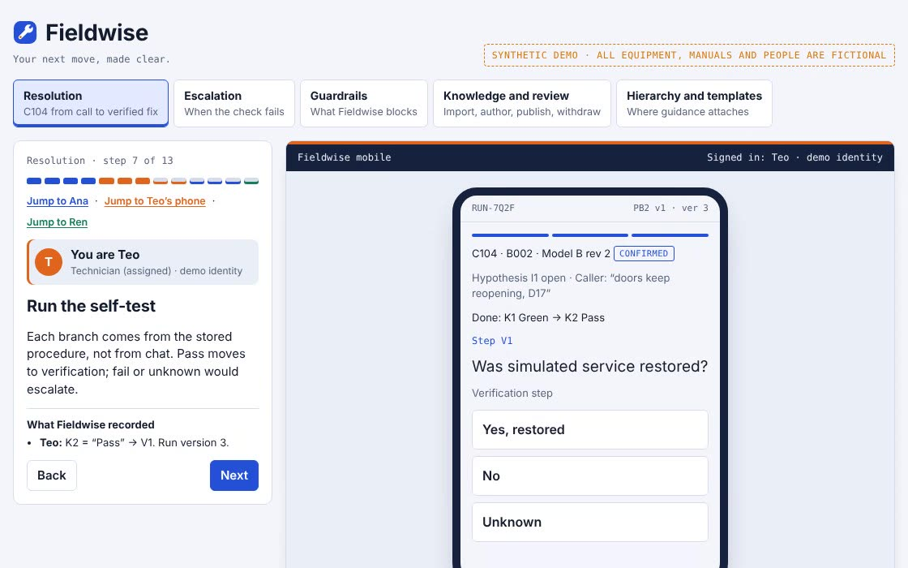

# Fieldwise

**Your next move, made clear.**

Fieldwise carries one equipment problem from the support call to a verified fix on a technician's phone. Every step is cited to a manual page, pinned to a reviewer-approved procedure version and recorded in an audit trail.

> All equipment, manuals, procedures, companies and people in this project are fictional. The in-app assistant uses scripted retrieval and response templates, not a live model.

**Live demo:** https://hithakishore-all.github.io/fieldwise/ (runs in your browser, no install)

## Why this exists

| Signal | Number | Source |
| --- | --- | --- |
| Cost of a failed first visit | Adds two more visits and 14 days on average | [Aquant 2025 Field Service Benchmark](https://salestechstar.com/predictive-ai-artificial-intelligence/aquants-2025-field-service-benchmark-report-reveals-ai-enabling-39-faster-machinery-repairs-and-more/) |
| First-time fix gap | 86% for top performers vs 53% for the bottom group | same report |
| Knowledge only experts hold | 30% of solutions appear only in expert-provided data | [Aquant Service Co-Pilot release](https://www.businesswire.com/news/home/20230517005191/en/Aquants-Service-Co-Pilot-Delivers-Generative-AI-Purpose-Built-for-Service) |
| AI trust gap | Gartner predicts more than 40% of agentic AI projects will be cancelled by the end of 2027 | [RCR Wireless](https://www.rcrwireless.com/20250627/business/agentic-ai) |

Everyone is adding AI answers. Fieldwise adds the approved next step: cited, pinned to the right model and carried from the call to the fix.

## Principles

| Principle | What Fieldwise does |
| --- | --- |
| Refuse to guess | Zero model-specific steps until a person confirms model and revision. Never inferred from a serial number. |
| Cite everything | Every answer and step points to a source revision plus page. Superseded and withdrawn content never appears. |
| Only approved steps | A past fix can support a hypothesis; only a published, applicable procedure authorizes a step. |
| Chat explains, people choose | The assistant can explain the current step but cannot pick a branch. |
| Pin and resume | A run is pinned to one procedure version; refresh or handoff restores the same run. |
| Separation of duties | Authors cannot publish their own procedures. Withdrawals pause live runs. |
| Exactly once | Retry keys, version checks and an outbox mean one tap and one host update count once. |

## The demo

Five guided scenarios, one person's screen at a time:

| Scenario | What it shows |
| --- | --- |
| Resolution | Case C104, "doors keep reopening, D17": clarify, confirm Model B rev 2, cited answer, handoff to the technician's phone, verified fix, one-time delivery to a mock service desk, reviewer trace |
| Escalation | Amber indicator → escalation with attempted steps and an open question; case switch clears context |
| Guardrails | 403s for the wrong person, chat can't choose, double tap counts once, stale write gets 409, corrected revision pauses the run, other tenants return 404 |
| Knowledge and review | JSON import with a rejected record, idempotent re-import, pathway validation, no self-approval, publish v2 while v1 runs, withdraw a procedure and a manual |
| Hierarchy and templates | Family → model → revision tree; fault codes at family level, manuals and procedures at revision level; one template filled per revision, blocked where a manual has no matching page |

## Status

| Part | State |
| --- | --- |
| PRD and research | Done |
| Guided browser demo (`demo/index.html`) | Done |
| Production build: Python 3.12, FastAPI, PostgreSQL (SQLite fallback), Jinja, pytest | In progress |

## License

MIT. See [LICENSE](LICENSE).
