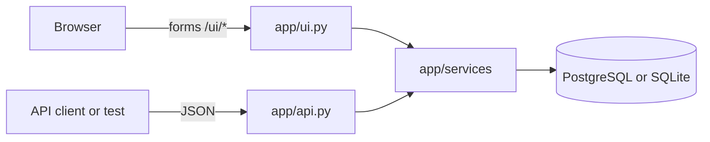
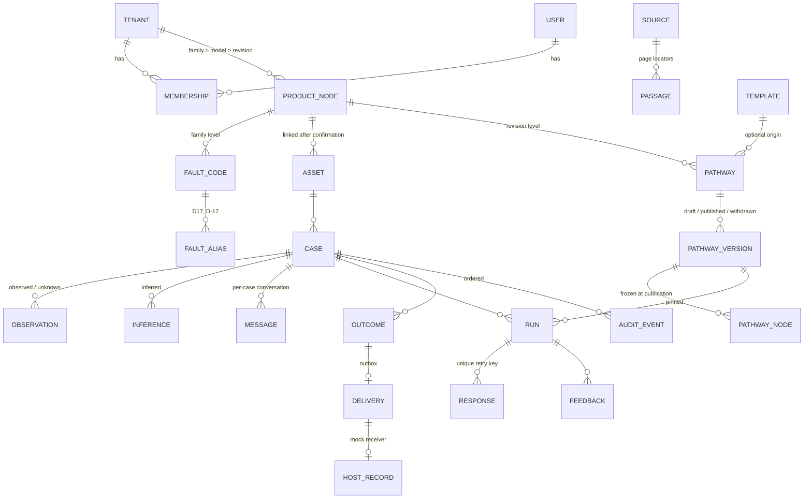
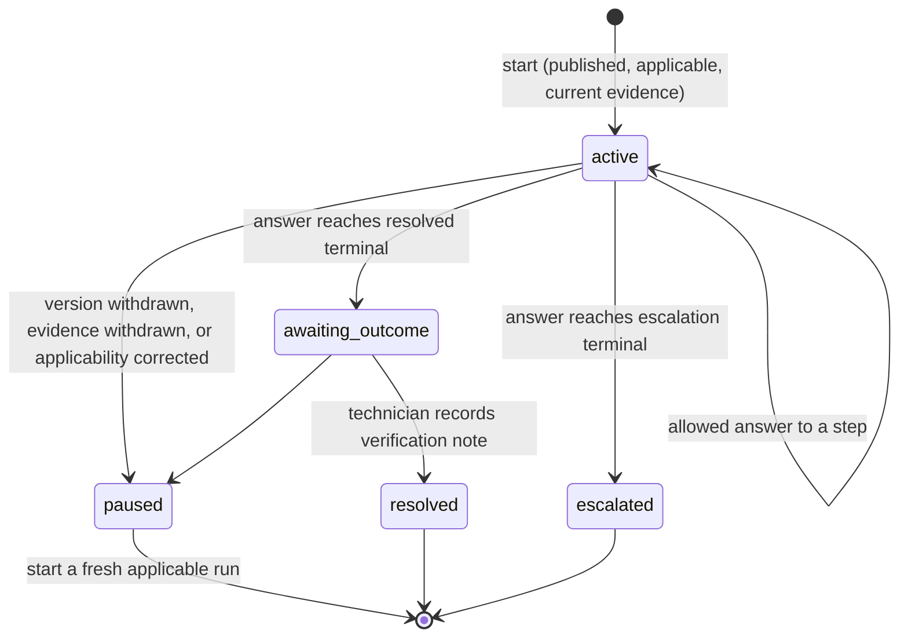

# Architecture

Fieldwise v0.1 is one FastAPI process with server-rendered Jinja pages and a relational database (PostgreSQL, or SQLite for a zero-install run). Browsers hold no case logic. Every rule below is enforced in `app/services/` and exercised by `tests/`.

## Components

| Component | Code | Job |
| --- | --- | --- |
| Session and access | `app/services/core.py` | Derives the demo identity from a signed server-side session; role checks; tenant-scoped lookups that return 404 for other tenants; audit writer |
| Assistant | `app/services/cases.py` · `ask` | Scoped retrieval with response templates: clarify when model or revision is missing, cite current passages, summarize history with denominators, list eligible procedures. During a run it only explains the current step |
| Pathway executor | `app/services/cases.py` · `start_run`, `respond`, `record_outcome` | Pins a published version, accepts only the assigned technician's allowed answers, commits answer + transition + audit + version bump together |
| Pathway authoring | `app/services/pathways.py` | Drafts, graph validation, publication (different reviewer, frozen nodes), withdrawal, source withdrawal, template application |
| Imports | `app/services/ops.py` · `run_import` | Checksummed, idempotent JSON manifests; per-record rejection with reasons |
| Outbox and mock host | `app/services/ops.py` · `approve`, `send`, `_receive` | One outbox row per approved outcome; the receiver deduplicates by delivery key and returns the same receipt on retry |
| JSON API | `app/api.py` | The contracts in the build prompt |
| Screens | `app/ui.py`, `app/templates/` | Mock host page with the embedded workspace, phone run view, knowledge, review, trace and hierarchy |



## Data model

Every business table carries `tenant_id`. Public identifiers (`C104`, `MB2`, `PB2`, `RUN-…`) are unique per tenant in a `key` column, never globally, and every read filters by the caller's tenant.



Key tables, all in `app/models.py`:

| Table | Notes |
| --- | --- |
| `product_nodes` | Hierarchy. Fault codes attach to the family; sources and pathways to a revision |
| `observations` | One fact each: field, value, original words, `status` (observed, inferred, unknown), `origin` (caller, agent_confirmation, suggestion, host), who supplied it |
| `sources`, `passages` | A source is one manual revision with `status` current, superseded or withdrawn. Citations are always source key plus passage locator |
| `historical_cases` | Attempts listed separately so only the verified attempt counts as the fix |
| `pathway_versions`, `pathway_nodes` | The definition JSON is validated before publication and copied into node rows; the executor branches from those rows |
| `runs` | `status` active, paused, awaiting_outcome, resolved or escalated; `version` bumps on every change |
| `responses` | Unique on `(run_id, retry_key)`; stores a hash of the request and the original response |
| `deliveries`, `host_records` | Transactional outbox and the mock host, both unique on `delivery_key` |
| `audit_events` | Autoincrement ID gives the order |

## Run state



## Step submission order

`POST /runs/{id}/responses` checks, in order:

1. Run exists in the caller's tenant, otherwise **404**.
2. Caller is the assigned technician, otherwise **403** (the attempt is audited).
3. Retry key already used: identical input from the same actor returns the **original response**; different input is **409**.
4. Run paused, or its version or cited evidence no longer approved: **409** with `runStatus: paused` (the run is paused first if needed).
5. `expectedVersion` matches the run, otherwise **409**.
6. `stepId` is the current step, otherwise **409**.
7. Answer is allowed at this step, otherwise **422** with the allowed list.
8. An `UPDATE … WHERE version = expected` bumps the version; if no row changes, another writer won and this request gets **409**. Answer, transition, audit event and new version commit together.

## Pathway validation

`app/services/pathways.validate` rejects a definition when:

- the start node or any edge target is missing;
- a step's allowed inputs repeat, an input has no edge, or an edge exists for an input not in the list;
- a node is unreachable from the start, or the graph has a cycle;
- there is no terminal, or an escalation has no open question;
- a citation's source is unknown, not current, for another model or revision, or has no such locator.

## Assistant response shape

```json
{
  "kind": "answer | clarify | escalate",
  "text": "…",
  "missingFields": ["model", "revision"],
  "citations": [{"sourceId": "MB2", "revision": "2", "locator": "p14", "page": 14, "text": "…", "url": "/evidence/MB2/p14"}],
  "eligiblePathways": [{"pathwayId": "PB2", "version": 1, "name": "…"}],
  "history": {"verified": 1, "total": 2, "label": "1 verified recovery in 2 matching cases", "cases": [{"id": "H1"}, {"id": "H2"}]}
}
```

## Audit event catalog

| Action | When |
| --- | --- |
| `case.opened` | Seed intake |
| `assistant.answered` | Any question, with kind and citations |
| `case.applicability_confirmed` | Agent confirms or corrects model and revision |
| `case.assigned`, `run.started` | Agent assigns and starts a pinned run |
| `run.step_answered` | Accepted answer, with step, answer, next node, version and citation |
| `run.response_blocked` | Someone other than the assigned technician tried to answer |
| `run.paused` | Withdrawal or correction paused a run |
| `case.resolved`, `case.escalated`, `case.closure_refused` | Outcomes |
| `run.feedback` | Step feedback |
| `host_update.approved`, `delivery.failed`, `delivery.delivered`, `delivery.retry_already_delivered` | Outbox |
| `import.completed`, `import.repeated` | Imports |
| `pathway.draft_saved`, `pathway.published`, `pathway.publish_rejected`, `pathway.withdrawn`, `source.withdrawn` | Authoring and review |
| `template.applied`, `template.apply_blocked` | Templates |

## Security model

- Identity comes only from the signed session cookie set by the demo identity picker. Request bodies never carry identity.
- Writes check role and ownership: agents confirm, assign, start and approve on cases they own; only the assigned technician answers steps and records outcomes; authors import and draft; a different reviewer publishes and withdraws.
- Reads are scoped by tenant through `scoped()`. A crafted key from another tenant is indistinguishable from a missing one: **404 Not found**, no title.
- The server binds to `127.0.0.1` unless `FIELDWISE_HOST` says otherwise.

## Design decisions

| Decision | Why |
| --- | --- |
| Server-rendered pages, little JavaScript | State lives on the server, so reload and handoff are free and nothing can drift |
| Executor independent of any language model | A published procedure runs during a model outage; chat can't choose a branch by construction |
| Frozen node rows per published version | A later edit can never change a run already in progress |
| Tenant-scoped public keys | The same demo key could exist in two tenants without leaking either |
| SQLite fallback | Anyone can try the full app in two minutes; PostgreSQL is the recommended database and the tests run on both |
