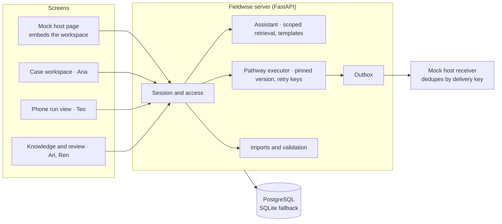
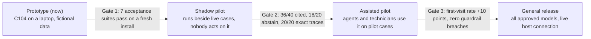

# Fieldwise PRD

*Your next move, made clear.*

Product requirements for Fieldwise (project codename Relayfield). Every target and estimate marked "proposed" is a proposal to confirm with a pilot sponsor. All equipment, manuals, procedures and people in the prototype are fictional.

## Summary

Fieldwise carries one equipment problem from the support call to a verified fix on a technician's phone. Every step is cited to a source page, pinned to an approved procedure version and recorded in an audit trail.

- **What it is:** a service-resolution workspace. A support agent confirms the exact equipment model, sees cited manual passages and similar past cases, and starts an approved branching procedure. A technician resumes that same procedure on a phone. A reviewer can trace and withdraw any procedure.
- **Who it's for:** contact-center support agents, field technicians, knowledge authors and procedure reviewers at companies that service complex equipment.
- **Status:** v0.1 prototype. Python, FastAPI, PostgreSQL (SQLite fallback for a zero-install demo), server-rendered pages. The in-app assistant is scripted retrieval with response templates, not a live model.
- **The bet:** service teams will trust AI help when it refuses to guess. Fieldwise gives zero model-specific steps until the model and revision are confirmed, and chat can explain a step but never choose a branch.

The demo case: a caller reports "doors keep reopening, D17." Two fictional elevator models share that code, and only one procedure is correct.

## Problem

A wrong first visit is expensive. Aquant's benchmark found that a failed first visit adds two more visits and 14 days on average, and AI answers that guess make the problem worse.

| Signal | Number | Source |
| --- | --- | --- |
| Cost of a failed first visit | "adds two additional visits on average, extending resolution timelines by 14 days" | [Aquant 2025 Field Service Benchmark](https://salestechstar.com/predictive-ai-artificial-intelligence/aquants-2025-field-service-benchmark-report-reveals-ai-enabling-39-faster-machinery-repairs-and-more/) |
| First-time fix gap | 86% for top performers vs 53% for the bottom group | same report |
| Wasted dispatch | "14% of truck rolls — one in seven onsite service visits — are unnecessary" | same report |
| Knowledge only experts hold | 30% of solutions appear only in expert-provided data, not historical records | [Aquant Service Co-Pilot release](https://www.businesswire.com/news/home/20230517005191/en/Aquants-Service-Co-Pilot-Delivers-Generative-AI-Purpose-Built-for-Service) |
| Workforce drain | "nearly half of field service engineers do not anticipate having a life-long career in the field"; half of those expect to leave within three years | [Service Council, via TechRadar](https://www.techradar.com/pro/field-workforce-exodus-threatens-global-infrastructure) |
| AI trust gap | Gartner predicts "more than 40% of agentic AI projects will be cancelled by the end of 2027," citing "inadequate risk controls" among the causes | [Gartner, via RCR Wireless](https://www.rcrwireless.com/20250627/business/agentic-ai) |

**Root causes**

1. **Shared fault codes hide different fixes.** Sibling models reuse codes such as D17, so a similar-sounding answer for the wrong model looks right.
2. **Context breaks at handoff.** The technician re-asks what the agent already learned, and the procedure version in use is not recorded.
3. **Similar cases are treated as authority.** A past fix that worked once gets repeated without an approved, current procedure behind it.
4. **Content goes stale silently.** Superseded manuals and withdrawn procedures keep showing up in search and in open tabs.
5. **Outcomes are not captured.** Without verified results by step, nobody can tell which guidance actually works.

**Customer evidence: what MaintainX clients report**

MaintainX customers got their biggest gains by turning paper procedures, asset records and audit trails into structured digital records. That structured base is exactly what Fieldwise needs to gate and cite guidance. All figures are vendor-published case studies, not independently verified.

| Customer | Setting | Before | What they digitized | Reported result |
| --- | --- | --- | --- | --- |
| [Titan America](https://www.casestudies.com/company/maintainx/case-study/how-titan-america-decreased-unplanned-maintenance-by-30-with-maintainx) | Building-materials plant, Florida; reliability program | Inspection and maintenance data in manual reports, hard to act on | 150+ procedures, 800+ assets, 2,700+ meters; ERP and dashboard integration | "greater-than-30% decrease in unplanned downtime" within a year |
| [Cottrell Organization](https://www.casestudies.com/company/maintainx/case-study/how-a-large-mcdonalds-franchise-reduced-equipment-downtime-by-85-with-maintainx) | 22 McDonald's franchises, NJ and PA; 60+ outside vendors | Fryer, compressor and shake-machine requests tracked by spreadsheet and phone | Work orders, standard procedures, messaging and audit trails | 85% less equipment downtime; mean time to repair from 400 to 60 hours |
| [ColdTrack](https://www.casestudies.com/company/maintainx/case-study/how-coldtrack-cooled-downtime-by-70-with-maintainx) | Cold-chain storage and shipping; SQF, OSHA, GMP and FDA rules | Paper records, slow audit prep, high parts spend | Paperless work orders, procedures, photos and meters | 70% less downtime; parts spend from about $28,000 to under $10,000 a month |

**Synthesis for Fieldwise**

1. **Procedures already exist as data.** Titan digitized 150+ procedures. Fieldwise should import CMMS procedures and asset records rather than ask authors to start over (a P1 import adapter).
2. **Speed came from knowing the next step.** Cottrell's repair time fell from 400 to 60 hours with standard procedures and one queue. Fieldwise adds the step that a shared fault code hides: which model's procedure applies.
3. **Audit trails are a buying reason.** ColdTrack works under food-safety audits. Fieldwise's ordered trace of evidence, steps and outcome serves the same buyer.
4. **The technician is often a third party.** Cottrell coordinates 60+ vendors. Tenant-scoped access and assignment-only step submission matter from day one.
5. **A second persona.** In-house maintenance technicians at plants and multi-site operators share the D17 problem with OEM field engineers, which widens the market beyond OEM service desks.

## Goals and non-goals

v0.1 proves one complete service case end to end on a local machine, with every visible action stored in a real database.

**Goals**

- Resolve case C104 from intake to a verified, delivered closure, and show the escalation path for the same case.
- Never show a model-specific step until the model and revision are confirmed by a person.
- Cite every answer to a source revision plus page locator; exclude superseded and withdrawn content.
- Let a technician resume the exact run and procedure version after a refresh or handoff.
- Give reviewers immutable published versions, withdrawal and an ordered audit trace.
- Run offline after install, with no API keys.

**Non-goals for v0.1**

- Parsing arbitrary PDFs (imports are structured JSON).
- A live CRM, production sign-in or single sign-on (a labeled demo identity picker stands in).
- A live language model (scripted retrieval and templates; a model is a later option).
- Offline field sync, log diagnosis, photo or audio capture, predictive maintenance.
- The 100-scenario pilot benchmark and any comparison against a commercial product.

## Users and personas

Four roles share one case. Each demo identity is fictional and lives in tenant North unless noted.

| Persona | Job to be done | Needs | Where they work |
| --- | --- | --- | --- |
| Ana, support agent | Turn a vague call into a confirmed model and an approved next step | Missing-fact prompts, cited passages, history with denominators, one-click handoff | Case workspace embedded in the host service desk |
| Teo, field technician | Finish the procedure on site without repeating intake | Current step, its evidence and only the allowed answers, on a phone | Mobile run view |
| Ari, knowledge author | Get manuals and procedures in, correct and current | Import report with accepted and rejected records, structured pathway editor, validation errors | Knowledge screen |
| Ren, reviewer | Approve what technicians may follow and pull it when wrong | Branch preview, publish, withdraw, step feedback, ordered case trace | Review screen |
| Mia (second North technician), Sol and Suri (South) | Test accounts that prove access rules | None; they must be blocked | Tests and demo |

## User stories and key scenarios

The hero run takes C104 from "doors keep reopening, D17" to a verified, delivered closure. Each other record proves one rule.

**Hero run (C104, resolution)**

1. **Intake.** Ana opens C104 inside the mock host page. She sees the caller's words verbatim, the known serial, and model and revision marked unknown.
2. **Clarify.** Ana asks about D17. Fieldwise asks for the model and revision and returns zero model-specific steps.
3. **Confirm.** Ana confirms Model B, revision 2. That is stored as her attributed observation, separate from any suggestion.
4. **Retrieve.** The same question now returns manual MB2 page 14, "1 verified recovery in 2 matching cases" with links to H1 and H2, and approved procedure PB2 v1. MA1 and superseded MB1 stay out.
5. **Hand off.** Ana starts PB2 v1 and assigns C104 to Teo.
6. **Execute.** On a phone, Teo reads indicator B (green), runs the self-test (pass) and confirms service restored. Each tap is saved; a refresh returns the same run and version.
7. **Close.** Ana previews the host update, approves it, and it is delivered once with a receipt, even after a simulated failure and retry.

**Escalation run.** The same case answered amber at K1, or no at V1, opens an escalation carrying the attempted steps and an open question.

**Demo records**

| Record | What it proves |
| --- | --- |
| C104 / asset B002 | Hero run: clarify, confirm, cite, hand off, execute, close |
| MA1 p8 (Model A rev 1) | A near-identical sibling instruction never appears for Model B |
| MB1 p9 (superseded) | Stale content is excluded from answers |
| MB2 p14 and p15 | Page-addressed evidence behind each procedure step |
| H1 and H2 history | Counts with denominators; an unknown outcome stays unknown; two attempts don't both count as fixes |
| PB2 v1 and v2 | Running cases stay pinned to v1 while new ones use v2; withdrawal pauses the run |
| PA1 (Model A path) | A separate approved path grounded only in MA1 |
| C105 | Separate conversation; switching cases clears context |
| South case S301 and SOUTH-ONLY-41 | Another tenant's case and evidence return 404 and zero search hits |
| Malformed import record | Rejected with a reason while valid records are kept |
| Template T-IND | One family-level template filled per revision; blocked where a manual has no matching page |

**Companion failure tests**

- **No identifier:** remove the model and leave the caller unable to confirm it. Fieldwise asks for identifying evidence or hands off, with zero model-specific steps.
- **Only an obsolete procedure:** with only superseded MB1 available, the interface explains why no guidance is shown.
- **Update test:** supersede the manual and withdraw PB2. New sessions exclude PB2; active sessions keep their audit trail and pause before the next withdrawn step.

## Functional requirements

P0 is everything the C104 demo needs; P1 and P2 extend the same case workflow later.

| ID | Requirement | Priority | v0.1 status |
| --- | --- | --- | --- |
| R1 | Import structured JSON manifests: source ID, external ID, model, revision, status, passages with locators; checksums; idempotent re-import; rejected records with reasons | P0 | Built (JSON only; PDF parsing deferred) |
| R2 | Observations record one fact, who supplied it, when, original words, and observed vs unknown | P0 | Built |
| R3 | Inferences link candidate causes to supporting observations and stay open until checked | P1 | Partly: I1 shown as inferred, closed by its check |
| R4 | Normalize fault aliases (D17, D-17) within product scope while keeping source text | P0 | Built |
| R5 | Cited search: answer, clarify or escalate; tenant, role, revision and publication filters before results | P0 | Built (scripted retrieval) |
| R6 | History summary with denominators; unknown outcomes labeled; history never authorizes a step | P0 | Built |
| R7 | Author a pathway as a structured definition; validate locators, answer domains, one edge per answer, reachability, terminals, no cycles | P0 | Built |
| R8 | Execute pathways: server-enforced role and assignment, persist each choice, deterministic transitions, chat cannot choose a branch | P0 | Built |
| R9 | Embed in a host page; reload, role handoff and case switch keep server-side state; stale writes rejected, retries deduplicated | P0 | Built (mock host) |
| R10 | Capture outcome, verification, actor, time, version and step feedback; reviewer sees the ordered trace | P0 | Built |
| R11 | Log diagnosis with line-level evidence | P1 | Not in v0.1 |
| R12 | Agent drafts a case update; save once after an authorized user confirms | P1 | Partly: host update preview and one-time delivery |
| R13 | Photo or audio observation attached to a step, accepted or corrected by the technician | P1 | Not in v0.1 |
| R14 | Offline field execution with conflict handling | P2 | Not in v0.1 |
| R15 | Predictive maintenance alerts evaluated on held-out periods | P2 | Not in v0.1 |
| R16 | Product hierarchy: family, model, revision. Fault codes attach at family level; manuals and pathways attach to a revision. Each asset links to one product node, set by a person | P0 | Built |
| R17 | Procedure templates at family level with slots; applying to a revision binds every slot to that revision's cited passage; an unbound slot blocks the draft; changes never auto-publish | P1 | Built |
| R18 | Asset hierarchy: tenant, site, bank, unit, with tenant scope enforced at every level | P1 | Built (site and location) |

## Trust, guardrail and non-functional requirements

Fieldwise would rather ask or escalate than guess. Every rule below is enforced on the server and covered by an automated test.

| Area | Requirement |
| --- | --- |
| Grounding | Every answer cites a source revision plus locator. Superseded or withdrawn sources never appear. Unknown questions return "insufficient evidence." |
| Applicability | Model and revision must both be confirmed by a person before any model-specific step. Never inferred from a serial prefix, case ID or chat guess. |
| Authority | Only an approved, published, applicable pathway version can authorize a next step. Similarity or a past fix alone never does. |
| Human control | Chat may explain the current step but cannot choose a branch. Only the assigned technician submits step results. Host updates go out only after agent approval. |
| Separation of duties | An author cannot approve their own pathway; publishing needs a different reviewer. |
| Least privilege | Case ownership and role checked on every write; tenant scope on every read, including evidence links, embeds and history. Forbidden = 403; another tenant's resource = 404 with no title leak. Identity comes from the server session. |
| Integrity | Optimistic version checks on every mutation. Retry keys make step submissions idempotent; a reused key with different input or a stale version returns 409. Answer, transition, audit event and version bump commit in one transaction. |
| Change control | Published versions are immutable. Withdrawal blocks new runs and pauses active ones before the next instruction. Withdrawing evidence invalidates dependent guidance. History is kept. |
| Delivery | Transactional outbox; receiver deduplicates by delivery key; a retry returns the original receipt. |
| Audit | Every visible workflow action writes an ordered audit event, including blocked attempts. |
| Operations | Binds to 127.0.0.1 by default. Demo and tests run offline with no API keys. Proposed target: median page and API response under 300 ms on a laptop with the demo data. |

## Solution overview and architecture

One FastAPI server renders every screen and owns all state; browsers hold no case logic. The pathway executor runs from stored definitions, so a published procedure works with no language model at all. See [ARCHITECTURE.md](ARCHITECTURE.md) for the data model and diagrams.

**Interfaces built first**

| Endpoint | What it does |
| --- | --- |
| `POST /imports`, `GET /imports/{id}` | Accept a source manifest; show counts, failures and revisions |
| `POST /cases/{id}/questions` | Answer, clarify or escalate, with citations, missing fields and eligible pathway versions |
| `POST /pathways/{id}/versions/{v}/publish` | Reviewer-only; requires a valid graph and a different person from the author |
| `POST /cases/{id}/runs` | Check applicability and publication, then pin the version |
| `POST /runs/{id}/responses` | Step ID, answer, expected version, retry key; one transaction with the audit event |
| `POST /cases/{id}/outcomes` | Record verification and queue the approved host update |

## Success metrics

The north star is **verified first-visit resolutions**: closures where the technician confirmed service restored on the first visit, following an approved, applicable procedure. Every target below is proposed.

| Type | Metric | Proposed pilot target |
| --- | --- | --- |
| North star | Verified first-visit resolution rate on pilot cases | +10 points over the sponsor's baseline |
| Adoption | Share of eligible cases where the agent starts an approved run | 60% |
| Adoption | Share of started runs the technician finishes on the phone | 80% |
| Quality | Supported answers that are correct and cite an applicable passage | 36 of 40 |
| Quality | Ambiguous or unanswerable questions met with a clarification or abstention | 18 of 20 |
| Quality | Multi-step runs whose recorded trace matches the expected path exactly | 20 of 20 |
| Trust | Technicians who rate the cited step as useful in step feedback | 70% |
| Guardrail | Model-specific steps shown before model and revision are confirmed | 0 |
| Guardrail | Cross-tenant disclosures or steps from withdrawn content | 0 (any one blocks release) |
| Guardrail | Duplicate host updates per closure | 0 |

**Evaluation plan.** Before tuning, the sponsor and a service expert freeze the corpus, model and revision map, approved procedures and 100 held-out scenarios: 40 supported questions, 20 ambiguous or unanswerable, 20 historical diagnoses and 20 multi-step runs. Run a keyword-search baseline on the same cases and access rights. Record ingestion time, cost, and median and p95 latency at a stated concurrency, separating measured from projected numbers.

## Competitive landscape

Everyone is adding AI answers; Fieldwise adds the approved next step, pinned to the right model and carried from the call to the fix. "Not described" means the public page is silent, not that the product lacks it.

| Vendor | Cited source passages | Model/revision gate before steps | Approved, versioned branching procedures | Same run resumed on phone | Verified outcome by step |
| --- | --- | --- | --- | --- | --- |
| [Neuron7 ResolutionGPT](https://www.businesswire.com/news/home/20230309005297/en/Neuron7-Introduces-ResolutionGPT-Generative-AI-to-Resolve-Issues-in-Complex-Service-Environments) and [Neuro](https://www.finanzen.net/nachricht/aktien/neuron7-launches-neuro-a-next-gen-ai-agent-for-mission-critical-service-resolution-15207654) | Not described | Not described | Guided "validated fixes" and step-by-step paths | Not described | Not described |
| [Aquant Service Co-Pilot](https://www.businesswire.com/news/home/20230517005191/en/Aquants-Service-Co-Pilot-Delivers-Generative-AI-Purpose-Built-for-Service) | Links to exact manual sections | Follow-up questions narrow answers | Not described | Not described | Not described |
| [MaintainX Assist](https://www.getmaintainx.com/blog/maintainx-copilot-ai-assistant-for-maintenance) | Not described | Not described | Generates procedures from uploaded guides; user edits, no sign-off described | Mobile CMMS | Work order history |
| [PTC ServiceMax AI](https://www.ptc.com/en/news/2025/ptc-launches-servicemax-ai) | Not described | Asset-specific answers | Not described | Not described | Not described |
| [Salesforce Agentforce for Field Service](https://www.salesforce.com/jp/news/press-releases/2025/04/15/agentforce-for-field-service-announcement/) | Not described | Not described | Conversational step-by-step troubleshooting | In the Field Service mobile app | Drafted post-job report |
| [Dynamics 365 Field Service Copilot](https://learn.microsoft.com/en-us/dynamics365/field-service/copilot-overview) | Not described | Not described | Not described | Mobile work order updates | Work order summaries |
| [IFS.ai Copilot](https://docs.ifs.com/ifsclouddocs/25r2/KnowledgeManagementSRV/IFSCopilotFieldServiceTechnician.htm) | Not described | Not described | Not described | Mobile Work Order app | Not described |
| **Fieldwise v0.1** | Source revision plus page on every answer | Required, by a person | Reviewer-published, immutable, withdrawable | Same run ID and version | Outcome, verification and step feedback |

## Rollout plan

Fieldwise moves from a laptop demo to general release in four phases; each opens only after its gate is met. Gate targets are proposed.

Gate 2 uses a frozen set of 100 held-out scenarios scored by a service expert; any cross-tenant disclosure or prohibited repair instruction blocks release at every gate. After general release, the same evidence and execution contracts extend to customer self-service with agent handoff, pre-dispatch parts checks against asset configuration, and triage by product and severity.

## Risks, dependencies and open questions

The largest risk is content: Fieldwise is only as good as the approved procedures behind it.

**Risks**

- **Thin procedure coverage.** Few approved pathways means many cases end in escalation. Mitigation: import existing CMMS or SOP procedures; track "missing content" in the reviewer queue.
- **Agents skip confirmation.** If confirming the model feels slow, agents may guess. Mitigation: one-tap confirm from asset facts; measure time to confirm.
- **Review bottleneck.** One reviewer per domain can stall publishing. Mitigation: branch preview and a validation report that does the mechanical checks.
- **Scripted assistant feels rigid.** v0.1 answers from templates. Mitigation: a model can phrase answers later, while the executor and gates stay model-independent.

**Dependencies**

- A pilot sponsor with real manuals, a model and revision map, and expert-approved procedures.
- An agreed host system, case fields, permitted writes and identity mapping before any live CRM link.

**Open questions**

- [ ] Which equipment family and how many models go into the first pilot?
- [ ] Who on the sponsor side reviews and publishes procedures, and how fast?
- [ ] Is the first host a CRM (agent desk) or a CMMS (maintenance team)?
- [ ] What is the sponsor's current first-visit resolution baseline?
- [ ] Do technicians need offline execution in the first pilot?

## Sources

- [Aquant 2025 Field Service Benchmark Report (SalesTechStar)](https://salestechstar.com/predictive-ai-artificial-intelligence/aquants-2025-field-service-benchmark-report-reveals-ai-enabling-39-faster-machinery-repairs-and-more/)
- [Aquant Service Co-Pilot release (Business Wire)](https://www.businesswire.com/news/home/20230517005191/en/Aquants-Service-Co-Pilot-Delivers-Generative-AI-Purpose-Built-for-Service)
- [Field workforce exodus, citing Service Council (TechRadar)](https://www.techradar.com/pro/field-workforce-exodus-threatens-global-infrastructure)
- [Gartner agentic AI prediction (RCR Wireless)](https://www.rcrwireless.com/20250627/business/agentic-ai)
- [Neuron7 ResolutionGPT release (Business Wire)](https://www.businesswire.com/news/home/20230309005297/en/Neuron7-Introduces-ResolutionGPT-Generative-AI-to-Resolve-Issues-in-Complex-Service-Environments)
- [Neuron7 Neuro launch (finanzen.net)](https://www.finanzen.net/nachricht/aktien/neuron7-launches-neuro-a-next-gen-ai-agent-for-mission-critical-service-resolution-15207654)
- [MaintainX Assist (MaintainX blog)](https://www.getmaintainx.com/blog/maintainx-copilot-ai-assistant-for-maintenance)
- [Titan America case study](https://www.casestudies.com/company/maintainx/case-study/how-titan-america-decreased-unplanned-maintenance-by-30-with-maintainx)
- [Cottrell Organization case study](https://www.casestudies.com/company/maintainx/case-study/how-a-large-mcdonalds-franchise-reduced-equipment-downtime-by-85-with-maintainx)
- [ColdTrack case study](https://www.casestudies.com/company/maintainx/case-study/how-coldtrack-cooled-downtime-by-70-with-maintainx)
- [PTC ServiceMax AI launch](https://www.ptc.com/en/news/2025/ptc-launches-servicemax-ai)
- [Agentforce for Field Service announcement (Salesforce)](https://www.salesforce.com/jp/news/press-releases/2025/04/15/agentforce-for-field-service-announcement/)
- [Copilot in Dynamics 365 Field Service (Microsoft Learn)](https://learn.microsoft.com/en-us/dynamics365/field-service/copilot-overview)
- [IFS.ai Copilot for field service technicians (IFS docs)](https://docs.ifs.com/ifsclouddocs/25r2/KnowledgeManagementSRV/IFSCopilotFieldServiceTechnician.htm)
